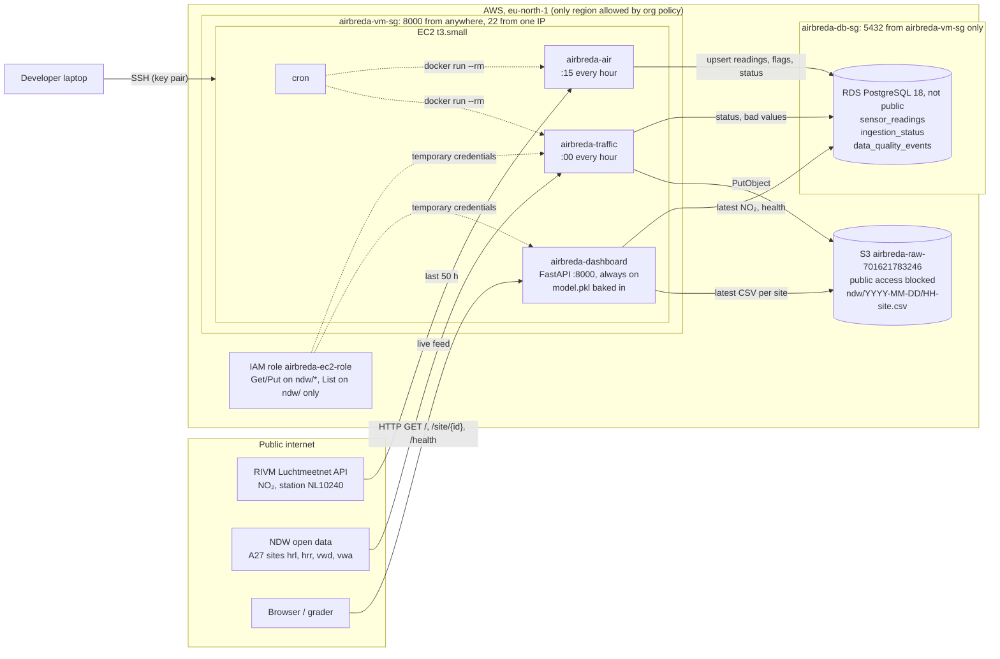

# AirBreda: architecture design document

BUas System Design & Cloud Platforms elective, 2026. Live system: <http://16.192.171.1:8000/> · Code: <https://github.com/SzymonChirowski242621/airbreda>

## 1. Architecture diagram

The system as deployed on 2026-11-25: two hourly ingestion jobs and a dashboard container on one VM, a private database, and a bucket for traffic history.

Trust boundaries:

- The database accepts connections only from the VM's security group. It is unreachable from the internet and from the laptop; development access goes through an SSH tunnel via the VM.
- The VM holds no AWS access keys. S3 access comes from the instance role, which can read and write objects under `ndw/` and list that prefix, and nothing else.
- The only secret on the VM is the database password, in a `.env` file with mode 600 that is not in git.
- Port 8000 is public so the dashboard can be graded. The app is read-only and serves only open data.

The model is trained offline (`build_training_data.py` on the VM, then `train_model.py` in the dashboard image) and shipped inside the dashboard image; see ADR-006.

## 2. Architecture Decision Records
| ADR | Topic |
|---|---|
| [ADR-001](adr/001-data-storage.md) | Initial Data Storage Strategy |
| [ADR-002](adr/002-messaging.md) | Messaging Architecture |
| [ADR-003](adr/003-resilience.md) | Resilience Strategy |
| [ADR-004](adr/004-compute.md) | Compute Strategy |
| [ADR-005](adr/005-deployment.md) | Compute & Deployment Strategy |
| [ADR-006](adr/006-ml-serving.md) | ML Serving Architecture |

Operations: [rebuild runbook](runbook-rebuild.md) (recovery procedure for ADR-003).

## 3. Trade-off justifications

**Storage (ADR-001).** I considered DynamoDB, Postgres, and keeping everything as files in S3. I chose Postgres for NO₂ and S3 for traffic. The NO₂ data is a fixed four-column schema queried by station and time range, and it grows by 8,760 rows a year; even 50 stations over five years is about 2.2 million rows, which one small Postgres instance handles easily. DynamoDB would scale further than we will ever need and would make the air-traffic join application code. Traffic went to S3 because NDW cannot be queried for the past, so the bucket is the only copy of that history and it has to be cheap and durable: 96 files a day at about 150 bytes each. What we gave up: the Day 4 training join spans two stores instead of one SQL query, and because we store per-site summaries instead of the raw XML, past hours cannot be re-parsed if the parser turns out to be wrong.

**Compute (ADR-004, ADR-005).** I considered one EC2 VM, ECS on Fargate with EventBridge Scheduler, and Lambda. I chose one `t3.small` VM running all three containers, at about $20 a month. The two ingestion jobs run for about 1 and 45 seconds an hour, and the dashboard needs about 300 MB of memory, so one small machine has room to spare. Fargate would remove the operating system from our responsibilities and charge only for the minutes the jobs run, but it needs a registry, task definitions, networking into the private database and, for the always-on dashboard, a load balancer at about $17.50 a month. What we gave up: we patch the OS ourselves, deployment is a manual SSH step, and the VM is a single point of failure for both ingestion and the API.

**Messaging (ADR-002).** I considered direct writes, a Redis list, and Amazon SQS. The deployment uses direct writes. The queue pattern was built and tested locally with Redis, including what happens when the broker is down, and SQS is the named production choice. At 5 messages an hour with one consumer per reading, a broker would be a process to run and monitor with nothing to decouple. What we gave up: adding a second consumer, such as live model scoring, means touching the ingestion code until a broker is deployed.

**Disaster recovery (ADR-003).** I considered backup and restore, pilot light, warm standby, and a second region. I chose backup and restore in eu-north-1 with a 99% monthly SLO (432 minutes of downtime allowed) and a 1-hour RTO. Pilot light would add about $20 a month (+55%) and warm standby about $53 (+146%), and neither protects against a regional outage, because the organisation policy allows only one region. Neither reduces the one loss that matters either: traffic hours missed while ingestion is down are gone. What we gave up: recovery takes an hour of manual work with the [rebuild runbook](runbook-rebuild.md), and the Free plan limits automated database backups to one day, so manual snapshots fill the gap.

## 4. Cloud provider rationale (municipal audience)

AirBreda runs on Amazon Web Services (AWS), one of the two large cloud providers that most Dutch organisations use. In practice this means that instead of buying and maintaining our own server, we rent a small amount of computing power, storage and a database from AWS and pay for what we use. The whole system currently costs about 35 dollars a month.

All data is stored in AWS's data centres in Stockholm, inside the European Union. The data itself is public information: air quality measurements from RIVM and traffic counts from the national road traffic data portal (NDW). It contains no personal data, so the privacy risk is low. Keeping it in the EU still matters, because it means European privacy law (the GDPR) applies to where and how it is stored.

AWS is a reasonable choice for a public-sector pilot like this for three reasons. First, it is reliable: the services we use are designed to keep stored data safe even if equipment fails. Second, it is cheap to start and easy to stop. There is no contract or upfront investment, and switching the system off ends the costs. Third, we built AirBreda from standard parts (a common database, ordinary files, and software packaged so it runs anywhere), so the municipality is not locked in.

There are things to weigh. AWS is an American company, so even with data in Stockholm, American law can in some cases require access to it. For open data like this that is acceptable; for systems with residents' personal data it would need a separate assessment. Microsoft Azure would be a good alternative, especially if the municipality already works with Microsoft, and it has a data centre in the Netherlands.

If we switched providers, we would keep all the data and the software. We would lose a few days of work to set the system up again on the new provider, and the hours of traffic data that are not collected while the move happens.

## 5. Cost estimate

Monthly cost at AWS on-demand prices for eu-north-1, from the AWS Price List API, assuming 730 hours a month. AWS prices in US dollars. A corridor is one interchange: four NDW traffic sites and one Luchtmeetnet station, ingested hourly.

| Component | Current (1 corridor) | 10 corridors | 50 corridors |
|---|---|---|---|
| Compute (VM) | $20.09: `t3.small` ($15.77), 8 GB disk ($0.67), public IPv4 ($3.65) | $20.09: same VM | $35.86: `t3.medium` ($31.54) with the same disk and IP |
| Database | $16.27: `db.t3.micro` ($13.87) and 20 GB gp3 ($2.40) | $16.27: same instance | $29.41: `db.t3.small` ($27.01) and 20 GB gp3 |
| Object storage | under $0.50 | under $1 | about $2 |
| **Total** | **about $37** | **about $37** | **about $67** |

Assumptions behind the numbers:

- Object storage is almost all request charges, not storage: each corridor writes 2,920 small files a month ($0.005 per 1,000 writes), and a year of files for one corridor is under 2 MB. The range depends on how often the dashboard is open, since each refresh lists and reads the latest files.
- The database grows by 8,760 rows a year per station. At 50 corridors that is about 440,000 rows a year, still small. The move to `db.t3.small` at 50 corridors is for more dashboard users and connections, not data volume.
- At 50 corridors the NDW parser has to be rewritten to read the national file once for all sites. The course's reference parser reads the whole file once per site, which takes about 11 seconds per site today: 200 sites would mean about 37 minutes of CPU an hour, more than a burstable `t3` instance can sustain.

Is one VM still the right choice? At 10 corridors, yes, without any change: the VM, database and bucket stay the same, and only the parser's run time grows from 45 seconds to about 7 minutes an hour. At 50 corridors with hourly ingestion, still yes, with a one-pass parser and a slightly larger VM. Cost is not what forces the change. What does is the ADR-004 threshold: ingesting every 5 minutes, or needing the API to survive a VM failure. At that point the jobs move to Fargate tasks on a schedule and the dashboard moves behind a load balancer, which adds roughly $17.50 a month for the load balancer alone.

## 6. Reflection

The first real alert this pipeline raised went into a log file that nobody was reading. At 03:00 on 24 November, NDW sent more than ten `speed=-1` values within an hour, and `BAD_DATA_THRESHOLD_EXCEEDED` fired exactly as designed. I only found it 32 hours later, with `grep`.

That sums up where I am least confident. The decision I would struggle to defend in a design review is storing per-site traffic summaries in S3 instead of the raw NDW XML. Every other choice in this system can be undone. That one cannot. NDW keeps no history, so if my parsing is wrong in a way I have not noticed (a lane counted twice, a vehicle class missed, a `-1` that should have been a zero), every hour collected so far carries that mistake, and nothing can re-parse it. To become confident I would need to check my per-site totals against an independent source, such as NDW's own aggregated statistics, for at least a few days. Storing the raw XML for the four sites as well would have cost almost nothing. I would do that from day one next time.

The model was trained on 46 hours. It gets the direction right (more traffic, more NO₂), it beats predicting the average, and it is not something I would put in front of a policy officer as a forecast. With a full year of readings I would change all three parts of it.

The features first. One snapshot per hour is a poor stand-in for an hour of traffic, so I would sample every five minutes and average. I would encode the hour as a cycle instead of a number from 0 to 23, add weekday versus weekend, and join weather from KNMI. Wind direction decides whether the A27's exhaust even reaches the station.

Then the algorithm. With around 8,700 hourly rows a gradient-boosted model becomes worth trying, because it can learn things like "rush hour with low wind" that a straight line cannot.

And the evaluation. I would use a rolling time-series split across seasons instead of one 12-hour test set. I would also compare against a much harder baseline than the average: "NO₂ will be what it was last hour". Air quality changes slowly, so that baseline is hard to beat, and any model worth serving has to beat it.

If AirBreda became a real system for the municipality, the first thing I would add is alerting that reaches a person. The logs are structured JSON, the health endpoint knows when a source is stale, and the bad-data threshold works. None of it notifies anyone. Shipping the logs to CloudWatch with an alarm that sends an email would have caught that first alert the hour it happened. After that, infrastructure as code, so the rebuild runbook becomes one command, and a CI pipeline that runs the 19 tests before anything reaches the VM.

The biggest lesson: most of this system is the work around the data. The model is two coefficients and an intercept in an 873-byte file. The hour alignment between two sources, the flags, the idempotent writes, the IAM policy and the runbook took far longer, and they are the parts that would still matter after the model is replaced.

<!-- GitHub Pages (Jekyll) does not render Mermaid by itself; this turns mermaid code blocks into diagrams. -->

