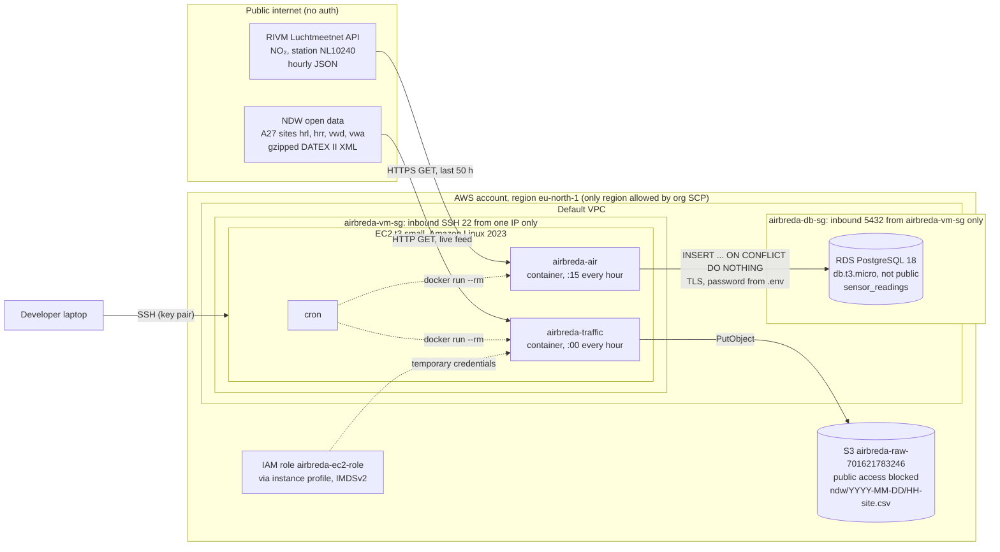

# AirBreda: architecture design document

> Work in progress. Published via GitHub Pages from `docs/`.

## 1. Architecture diagram

State after Day A (2026-11-23): ingestion only. The dashboard container is added on Day 4.

Trust boundaries: the database accepts connections only from the VM's security group, so it is unreachable from the internet and from the laptop. The VM has no AWS access keys; S3 access comes from the instance role. The only secret on the VM is the database password in a `.env` file with mode 600, which is not in git.

## 2. Architecture Decision Records
| ADR | Topic |
|---|---|
| [ADR-001](adr/001-data-storage.md) | Initial Data Storage Strategy |
| [ADR-002](adr/002-messaging.md) | Messaging Architecture |
| [ADR-003](adr/003-resilience.md) | Resilience Strategy |
| [ADR-004](adr/004-compute.md) | Compute Strategy |
| ADR-005 | Compute & Deployment Strategy |
| ADR-006 | ML Serving Architecture |

## 3. Trade-off justifications
## 4. Cloud provider rationale (municipal audience)
## 5. Cost estimate
## 6. Reflection

<!-- GitHub Pages (Jekyll) does not render Mermaid by itself; this turns mermaid code blocks into diagrams. -->

