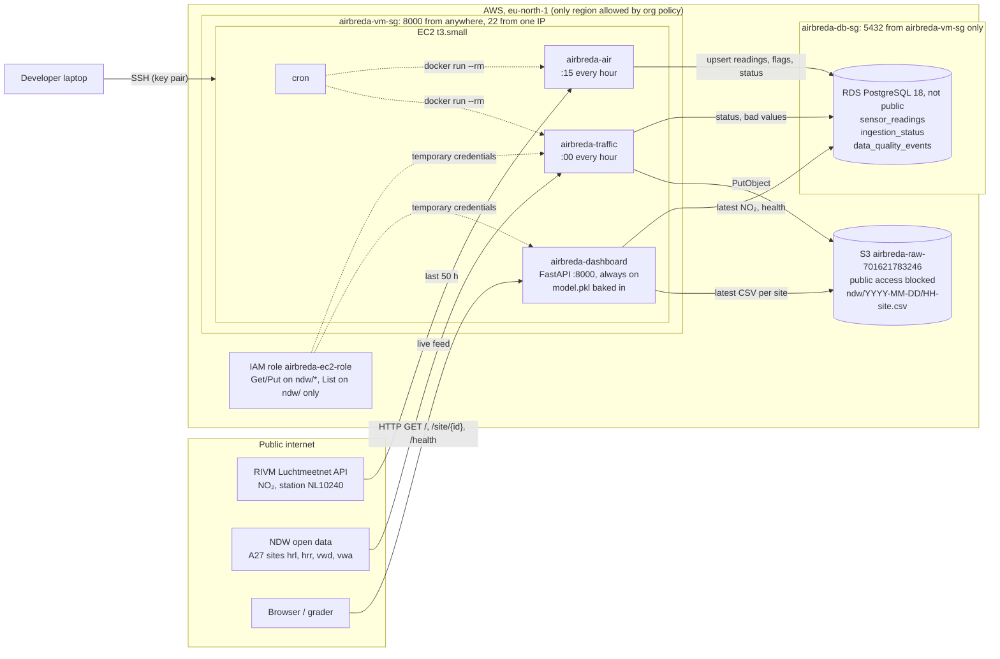

# AirBreda: architecture design document

> Work in progress. Published via GitHub Pages from `docs/`.

## 1. Architecture diagram

The system as deployed on 2026-11-25: two hourly ingestion jobs and a dashboard container on one VM, a private database, and a bucket for traffic history.

Trust boundaries:

- The database accepts connections only from the VM's security group. It is unreachable from the internet and from the laptop; development access goes through an SSH tunnel via the VM.
- The VM holds no AWS access keys. S3 access comes from the instance role, which can read and write objects under `ndw/` and list that prefix, and nothing else.
- The only secret on the VM is the database password, in a `.env` file with mode 600 that is not in git.
- Port 8000 is public so the dashboard can be graded. The app is read-only and serves only open data.

The model is trained offline (`build_training_data.py` on the VM, then `train_model.py` in the dashboard image) and shipped inside the dashboard image; see ADR-006.

## 2. Architecture Decision Records
| ADR | Topic |
|---|---|
| [ADR-001](adr/001-data-storage.md) | Initial Data Storage Strategy |
| [ADR-002](adr/002-messaging.md) | Messaging Architecture |
| [ADR-003](adr/003-resilience.md) | Resilience Strategy |
| [ADR-004](adr/004-compute.md) | Compute Strategy |
| [ADR-005](adr/005-deployment.md) | Compute & Deployment Strategy |
| [ADR-006](adr/006-ml-serving.md) | ML Serving Architecture |

Operations: [rebuild runbook](runbook-rebuild.md) (recovery procedure for ADR-003).

## 3. Trade-off justifications
## 4. Cloud provider rationale (municipal audience)
## 5. Cost estimate
## 6. Reflection

<!-- GitHub Pages (Jekyll) does not render Mermaid by itself; this turns mermaid code blocks into diagrams. -->

